<p align="center">
  <picture>
    <source media="(prefers-color-scheme: dark)" srcset="docs/logo-dark.svg">
    
  </picture>
</p>

<p align="center">
  Des aventures Pokémon entre amis, chacun dans sa propre partie : vous vous voyez dans le monde du jeu, vous échangez et vous vous affrontez, en temps réel. Rien à installer, aucun serveur : tout tourne dans le navigateur.<br>
  <a href="https://swagedencool.github.io/eden-pokelink/"><b>Jouer</b></a> · <a href="../../releases">Nouveautés</a> · <a href="docs/TECHNIQUE.md">Notes techniques</a>
</p>

<p align="center">
  <a href="../../releases/latest"></a>
  <a href="../../actions/workflows/publier-site.yml"></a>
  
  
</p>

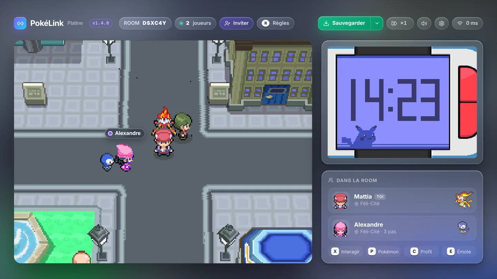

> Pour l'instant, seul **Pokémon Platine** (version française) est testé de bout en bout. Les autres jeux de la Gen 1 à 5 se lancent et passent dans le randomizer, mais le jeu à plusieurs n'y fonctionne pas encore.

## Fonctionnalités

### Jouer ensemble, chacun dans sa partie

Chacun charge sa propre ROM et sa propre sauvegarde. Dans la même room, on se voit dans le monde du jeu, avec son pseudo, sa tenue et son Pokémon qui suit (comme dans HeartGold/SoulSilver). La liste « Dans la room » indique où est chacun, et un badge prévient quand un ami est en combat ou en échange. Pour inviter quelqu'un, il suffit de lui envoyer le lien de la room.

<table>
  <tr>
    <td width="50%">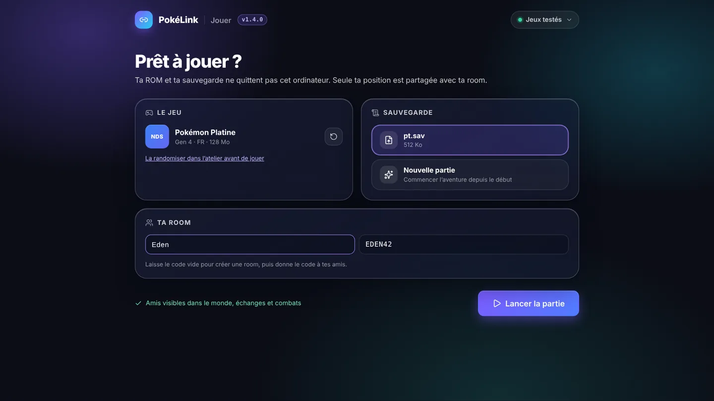</td>
    <td width="50%">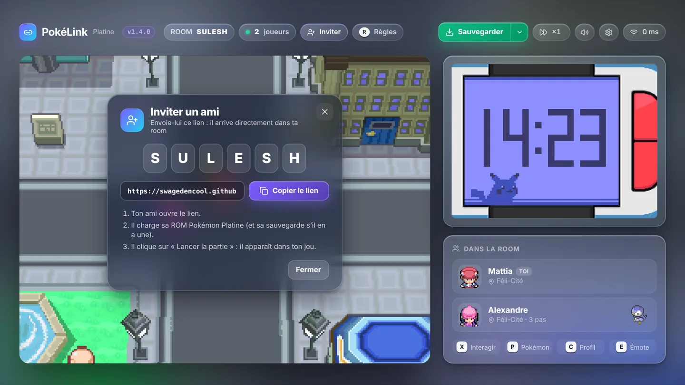</td>
  </tr>
  <tr>
    <td align="center"><sub>La ROM et la sauvegarde ne quittent pas ton ordinateur</sub></td>
    <td align="center"><sub>Un lien suffit pour rejoindre la room</sub></td>
  </tr>
</table>

### Échanger, combattre, regarder l'équipe des autres

Clique sur un ami, dans le jeu ou dans la liste, pour ouvrir son menu. Les échanges sont synchronisés : le Pokémon reçu est écrit directement dans ta partie, avec les vraies stats du jeu. Les combats sont simulés par le moteur de Pokémon Showdown (règles de la 4e génération), en simple (3 contre 3) ou **en duo** (4 contre 4, deux Pokémon chacun sur le terrain). Le résultat, PV et K.O. compris, est réécrit dans ta partie.

<table>
  <tr>
    <td width="50%">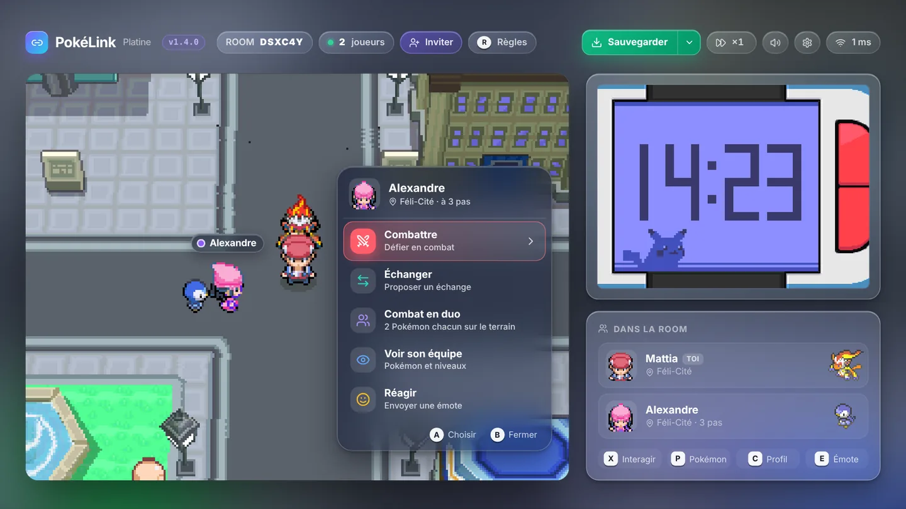</td>
    <td width="50%">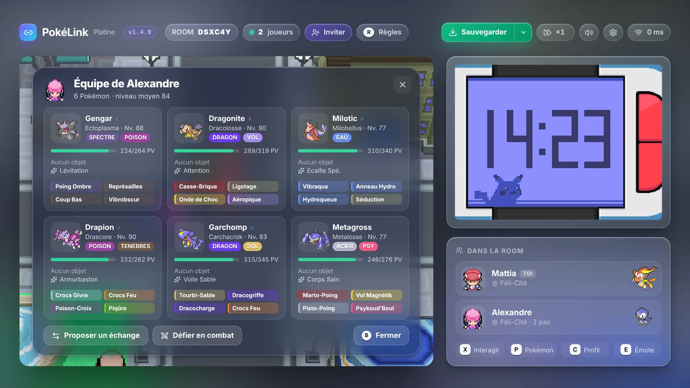</td>
  </tr>
  <tr>
    <td align="center"><sub>Menu d'un ami : échange, combat, duo, équipe, émotes</sub></td>
    <td align="center"><sub>Son équipe : types, PV, objet, talent, attaques</sub></td>
  </tr>
  <tr>
    <td>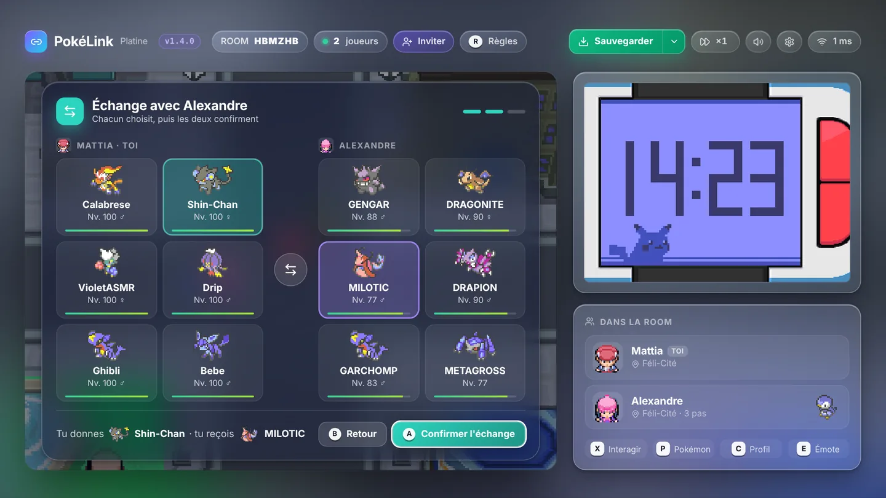</td>
    <td>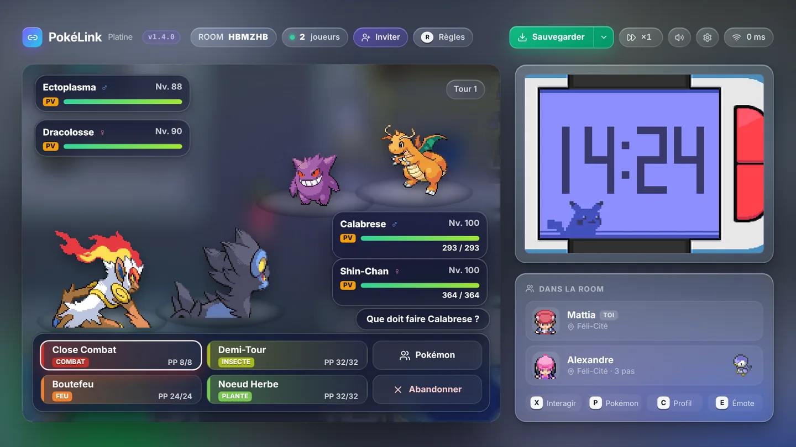</td>
  </tr>
  <tr>
    <td align="center"><sub>Échange : chacun choisit, puis les deux confirment</sub></td>
    <td align="center"><sub>Combat en duo : deux Pokémon de chaque côté, on choisit la cible</sub></td>
  </tr>
</table>

### Nuzlocke à plusieurs : les règles de la room

- **Âmes liées** : les Pokémon rencontrés au même endroit par des amis différents sont liés. Si l'un tombe K.O., les autres aussi, et ils le restent même après un Centre Pokémon.
- **Plafond de niveau** : automatique (niveau du prochain champion, lu dans ta ROM, donc juste même randomisée) ou fixe. Au plafond, plus d'EXP en combat ni à la Pension, et le Super Bonbon n'a plus d'effet.

N'importe quel joueur peut les activer ou les couper à tout moment. Les amis qui arrivent les reçoivent automatiquement.

<p align="center">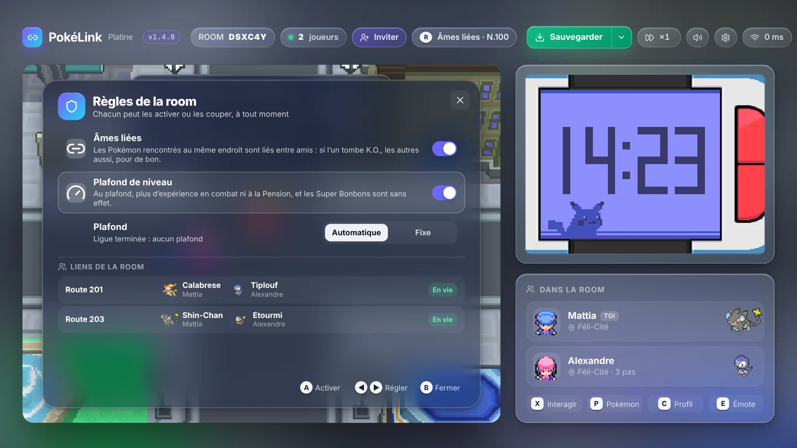</p>

### Atelier ROM : l'Universal Pokémon Randomizer, en français, dans le navigateur

Tous les réglages de l'Universal Pokémon Randomizer ZX, traduits, avec des formules prêtes (Nuzlocke, Aventure entre amis, Duo, Chaos total) et un **random map** où chaque porte mène ailleurs. Avec la même ROM, les mêmes réglages et la même graine, tout le monde a la même aventure. Le randomizer tourne dans ton navigateur, donc ta ROM ne quitte jamais ton ordinateur.

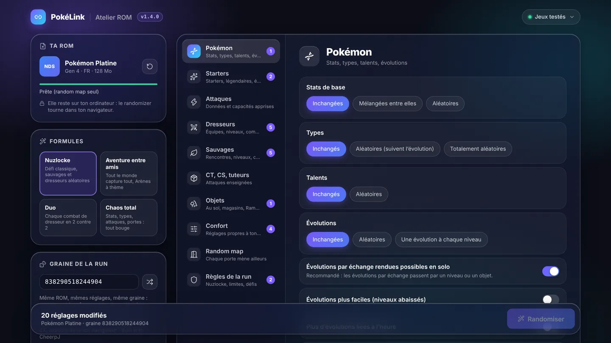

### Ton personnage

Pseudo, Lucas ou Aurore, couleurs du bonnet, du manteau et des détails, Pokémon compagnon. Tes amis te voient tout de suite, et ta tenue s'applique aussi dans ta propre partie : à pied, à vélo, en surf.

<p align="center">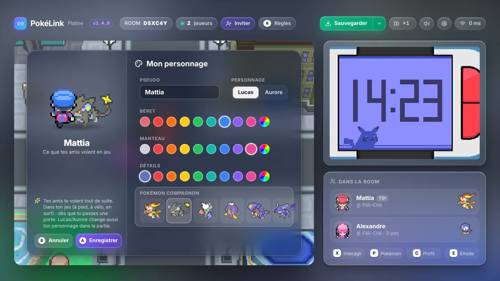</p>

### Confort

- **Souris partout** : menus, échanges et combats. Sur l'écran du haut, un clic fait marcher jusqu'à la case visée, ou parler à quelqu'un. L'écran du bas se touche comme avec un stylet.
- **Réglages** : toutes les touches modifiables (la disposition AZERTY est reconnue), volume, accélération de ×1,5 à ×4, filtres d'image (Net et régulier, Contours HD, Écran LCD).
- **Sauvegarde guidée** : sauvegarde d'abord dans le jeu, puis télécharge ton `.sav`. La partie est aussi gardée dans le navigateur.
- **Le jeu continue en arrière-plan**, même quand la fenêtre n'est pas au premier plan.

<table>
  <tr>
    <td width="50%">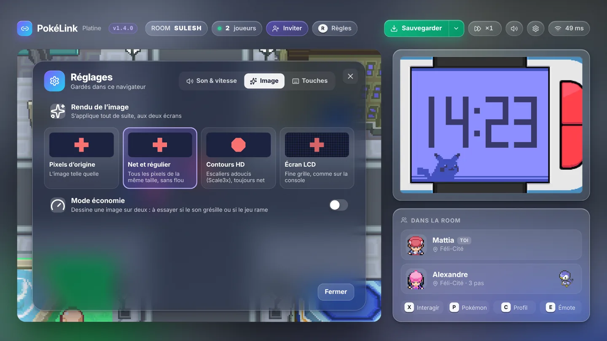</td>
    <td width="50%">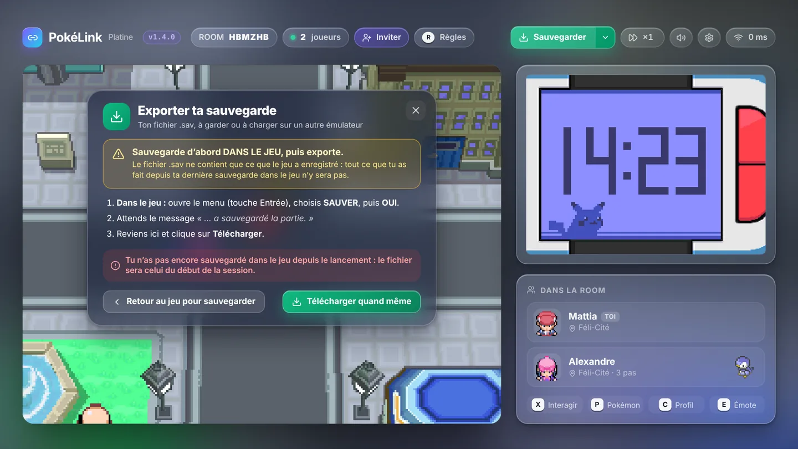</td>
  </tr>
  <tr>
    <td align="center"><sub>Réglages : son, vitesse, image et touches</sub></td>
    <td align="center"><sub>Sauvegarde : d'abord dans le jeu, ensuite le fichier</sub></td>
  </tr>
</table>

## Jouer

1. Va sur **[swagedencool.github.io/eden-pokelink](https://swagedencool.github.io/eden-pokelink/)**, puis *Jouer*.
2. Charge ta ROM de Pokémon Platine et ta sauvegarde (ou commence une nouvelle partie).
3. Lance la partie, puis clique sur **Inviter** (en haut) et envoie le lien à tes amis.

Touches par défaut (modifiables dans *Réglages*) : flèches = croix, X = A, Z = B, S = X, A = Y, Q/W = L/R, Entrée = Start, Retour = Select, P = Pokémon qui suit, C = profil, E = émote, R = règles, Espace = accélérer.

Aucun jeu n'est fourni : chacun utilise les dumps de ses propres cartouches.

## Fonctionnement

- **Aucun serveur.** C'est un site statique. Les joueurs se trouvent grâce au code de room (relais Nostr publics, via [Trystero](https://github.com/dmotz/trystero)), puis se connectent directement entre eux en WebRTC.
- **Émulateur** : [EmulatorJS](https://github.com/EmulatorJS/EmulatorJS) et le cœur DeSmuME en WebAssembly. PokéLink lit la mémoire du jeu (position, carte, équipe) pour afficher les amis au bon endroit et y écrire les échanges et les combats.
- **Combats** : [@pkmn/sim](https://github.com/pkmn/ps), le moteur de Pokémon Showdown, simulé dans le navigateur d'un des deux joueurs.
- **Randomizer** : [Universal Pokémon Randomizer ZX](https://github.com/Ajarmar/universal-pokemon-randomizer-zx), un programme Java exécuté dans le navigateur grâce à [CheerpJ](https://cheerpj.com).
- Le reste est du JavaScript simple, sans framework ni bundler. Détails : [docs/TECHNIQUE.md](docs/TECHNIQUE.md).

## Développement

```sh
cd web && python3 -m http.server 8000     # le site en local : http://localhost:8000
cd server && npm install && npm test      # tests (rooms, format 4G, random map, combats, atelier)
sh tools/build-site.sh                    # le site prêt à publier dans dist/ (refuse toute ROM ou sauvegarde)
```

Publier une release sur GitHub met le site en ligne automatiquement ([publier-site.yml](.github/workflows/publier-site.yml)). Le numéro de version s'affiche en haut de chaque page.

## Licence

PokéLink est sous GPL-3.0, comme EmulatorJS et l'Universal Pokémon Randomizer. Composants tiers : [THIRD_PARTY.md](THIRD_PARTY.md).
Projet de fans, sans lien avec Nintendo, Game Freak, Creatures ou The Pokémon Company. Pokémon est une marque de Nintendo, Creatures et Game Freak.

Merci à **Alexandre**, bêta-testeur de la première heure.

Design et développement : [Eden Bourezg](https://edenbourezg.myportfolio.com).
